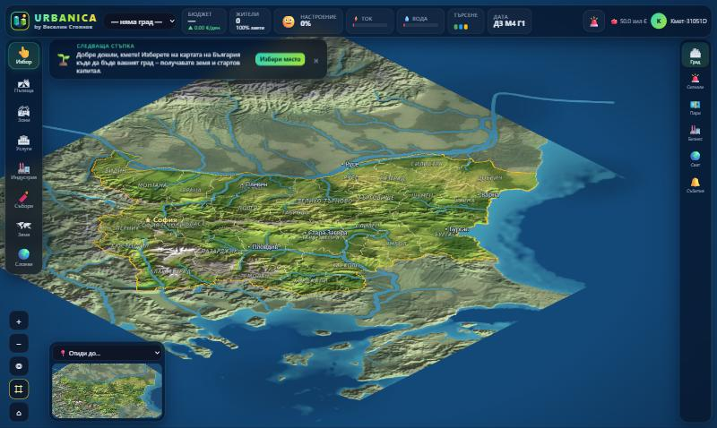
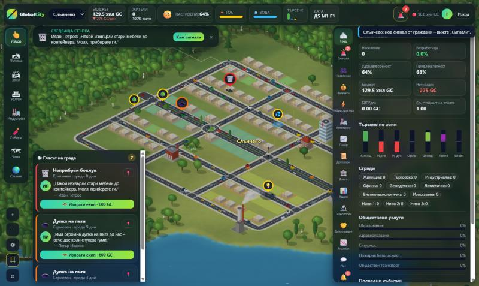

<p align="center"></p>

# Urbanica

**Построй държава от нулата.** Игра, създадена от **Веселин Стоянов**.



Постоянна онлайн браузърна градостроителна и икономическа симулация. Играчите споделят един процедурно генериран свят, строят градове чрез зониране, развиват индустрии и производствени вериги, търгуват на общ пазар, основават корпорации, теглят кредити, изследват технологии и сключват съюзи. Светът продължава да се развива, когато играчът е офлайн. Играта е **напълно безплатна** – няма платени функции, валута или предимства.

> Статус: **онлайн алфа (локално проверена)**. Какво работи, какво е опростено и какво предстои – вижте [docs/STATUS.md](docs/STATUS.md).

## Основни функции (реализирани)

- **Без регистрация и вход**: при първо отваряне играта създава автоматичен играч (кмет), браузърът го помни; всичко се пази на сървъра в PostgreSQL.
- **Реалната България**: истински релеф (планини, равнини, речни долини), Дунав и реките, Черноморието, **28-те области** с реалните им граници и имената на градовете за ориентация. Съседните страни и морето са само фон. **Светът започва празен** – няма готови градове; всеки играч избира сам къде в България да основе град и започва от нулата със стартов капитал в **евро**.
- Изометрична 2.5D карта (PixiJS) с реалистична процедурна графика: терен без видима решетка, гладки реки, пътища с маркировка, тротоари и кръстовища, библиотека от сгради с варианти, гори от различни дървета; 3 нива на детайлност, плавно мащабиране, тъч управление, превключваеми административни граници и 10 аналитични слоя. Виж [docs/graphics](docs/graphics/README.md).




- Жив град: коли по улиците, дим, облаци, отблясъци по водата; **сигнали от гражданите** (дупки, аварии, боклук, катастрофи…), които кметът отстранява с ремонтни екипи.

- Пътища в 5 категории (улица, булевард, градска магистрала, индустриален, селски), кръгови движения и светофари, 7 вида зони, 12 вида обществени сгради, автоматично развитие/упадък/изоставяне на сгради според търсенето, услугите и рентабилността; купуване на съседни парцели (териториална експанзия), множество градове.
- Население по образователни групи, трудов пазар със заплати, образование с времезакъснение, миграция между градовете, наеми и удовлетвореност.
- Ток, вода, канализация, отпадъци, трафик/обществен транспорт, здравеопазване, образование, полиция, пожарна – с капацитет, разходи и приоритети при недостиг.
- Компании с 11 вида съоръжения и вериги (руда+въглища → стомана → стоки → машини; зърно → храни), складове, наличности, доставки с време и цена, модернизация с машини.
- Общ пазар с книга на поръчките (ескроу, атомарно съпоставяне), градско потребление, световен внос/износ, динамични цени (търсене/предлагане + себестойност), мита и санкции.
- Договори за периодични доставки с неустойки; кредити с рейтинг, анюитет, просрочие, неизпълнение, преструктуриране, несъстоятелност; централна банка с правило тип Тейлър.
- Акции, търговия с акции, придобиване на контрол (дъщерни дружества), гласуване по предложения (дивиденти, емисии, назначения, продажба на активи, сливания), роли CEO/мениджър/борд.
- Изследвания, патенти (1 година), лицензи, публично финансирани изследвания.
- Съюзи (търговски блокове без мита), покани, гласуване за санкции и изключване.
- Чат (общ, лични, корпоративни, съюзни), приятели, блокиране, докладване, модерация, известия, новини, класация.
- Аналитика: графики, прогнози, инвестиционен симулатор, публични и поверителни отчети.
- Адаптивен интерфейс за компютър, таблет и телефон.

## Технологии

TypeScript навсякъде · React 19 + Vite 7 + PixiJS 8 + Recharts · NestJS 11 (REST + socket.io) · отделен Node worker за симулацията · PostgreSQL + Prisma 6 · Vitest · монорепо с npm workspaces. Подробности: [docs/architecture](docs/architecture/README.md).

## Предварителни изисквания

- Node.js 22 LTS (минимум 20.19) и npm 10.
- PostgreSQL 15+ **или** вграденият локален сървър (`npm run db:start`), който не изисква инсталация (пакет `embedded-postgres`).
- Redis **не е нужен** за алфата (виж решенията в архитектурата).

## Инсталиране и локално стартиране

```bash
npm install
cp .env.example .env            # Windows: copy .env.example .env
npm run db:start                # оставете този терминал отворен (PostgreSQL на порт 5433)
```

В нов терминал:

```bash
npm run build                   # prisma generate + компилиране на всички пакети и клиента
npm run db:migrate              # прилага миграциите към DATABASE_URL
npm run db:seed                 # създава света (идемпотентно)
npm run dev:api                 # API на http://localhost:3000 (обслужва и билднатия клиент)
npm run dev:worker              # симулационният worker (отделен терминал)
npm run dev:web                 # Vite dev сървър на http://localhost:5173 (по желание, с hot reload)
```

Отворете http://localhost:5173 (разработка) или http://localhost:3000 (билднат клиент), регистрирайте се и основете град.

Тестовата база `gce_test` се създава автоматично от `npm run db:start`. За миграции към нея:

```bash
npx prisma migrate deploy --schema packages/database/prisma/schema.prisma   # с DATABASE_URL=.../gce_test
```

## Тестове

```bash
npm run test:unit               # unit тестове (формули, пазар, производство, свят, градска симулация)
npm run test:integration        # интеграционни + E2E (изисква gce_test и билднат API)
npm test                        # всички
npm run test:econ               # икономическа симулация с ботове (отделна база gce_test) + проверка на инварианти
node scripts/load-test.mjs http://localhost:3000 40 20   # тест при натоварване
npm run lint && npm run format:check
```

Резултати и покритие: [docs/testing](docs/testing/README.md).

## Production build и публикуване

```bash
npm run build                   # създава apps/*/dist и apps/web/dist
NODE_ENV=production node apps/api/dist/main.js      # API + статичен клиент
NODE_ENV=production node apps/worker/dist/main.js   # worker (отделен процес)
```

Контейнер: `Dockerfile` (един образ за API и worker). Облак: `render.yaml` (Render Blueprint – уеб услуга, worker, PostgreSQL). Стъпки, променливи на средата, резервни копия, наблюдение: [docs/deployment](docs/deployment/README.md).

## Резервни копия

```bash
npm run db:backup                              # backups/gce-<време>.json.gz
node scripts/db-restore.mjs <файл> --yes       # ВНИМАНИЕ: заменя данните; спрете API и worker преди това
```

## Документация

| Тема                                           | Файл                                                       |
| ---------------------------------------------- | ---------------------------------------------------------- |
| Текущо състояние, ограничения, следващи стъпки | [docs/STATUS.md](docs/STATUS.md)                           |
| Архитектура и поток на данните                 | [docs/architecture/README.md](docs/architecture/README.md) |
| Графика, генератор на държавата, снимки        | [docs/graphics/README.md](docs/graphics/README.md)         |
| Игрови дизайн и механики                       | [docs/gameplay/README.md](docs/gameplay/README.md)         |
| Икономически модел и формули                   | [docs/economy/README.md](docs/economy/README.md)           |
| База данни, ledger, миграции                   | [docs/database/README.md](docs/database/README.md)         |
| API и WebSocket събития                        | [docs/api/README.md](docs/api/README.md)                   |
| Сигурност                                      | [docs/security/README.md](docs/security/README.md)         |
| Тестване и резултати                           | [docs/testing/README.md](docs/testing/README.md)           |
| Публикуване и експлоатация                     | [docs/deployment/README.md](docs/deployment/README.md)     |

Имената на файлове, функции, променливи и API полета са на английски за съвместимост с инструментите.
