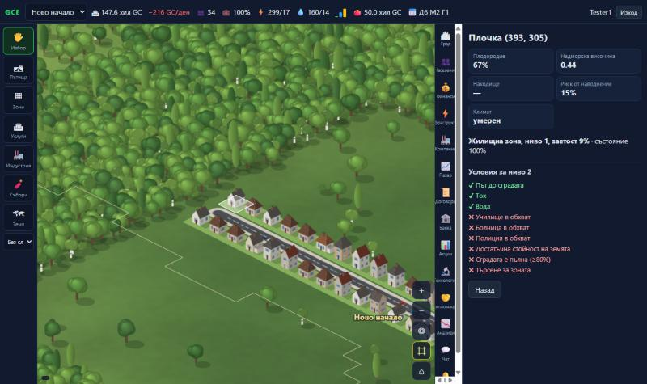

# Игрови дизайн

## Цел и прогрес

Няма нива и изкуствено отключване. Прогресът идва от капитал, производителност, технологии, инфраструктура, квалифицирани работници, достъп до пазари и управленски решения. Всички играчи имат еднакъв достъп до всички функции; играта е безплатна.

## Начало

1. Регистрация → личен портфейл 50 000 €.
2. Основаване на град → 3×3 парцела (24×24 плочки) на свободна суша, далеч от други градове; бюджет 200 000 €.
3. Пътища → зони → ток и вода → сградите се появяват сами при търсене.
4. Компания (от портфейла) → предприятия в града → търговия, договори, кредити, изследвания.

## Карта и управление

- Изометричен изглед; мишка: влачене с „Избор“, десен/среден бутон – винаги придвижване, колело – мащаб; тъч: един пръст – придвижване/рисуване, два – pinch-to-zoom.
- Инструменти: Избор (информация за плочка), Пътища (L-линия при влачене; категории улица, булевард, градска магистрала, индустриален, селски; кръгово движение, светофари), Зони (правоъгълник), Услуги (една плочка), Индустрия (предприятие на активната компания), Събаряне, Земя (купуване на съседен парцел).

### България и стартът от нулата

Няма регистрация и вход: играта създава автоматичен играч („Кмет-XXXXXX“) при първото отваряне и браузърът го помни. Картата е реалната България с 28-те области. Изберете „Избери място“ (или „Град → Избери място на картата“), напишете име и щракнете където искате – зеленото поле показва подходящо място (суша в България, свободни парцели). Ако мястото не става, сървърът избира най-близкото подходящо в радиус ~6 парцела или обяснява защо не може. Парите са в **евро (€)**. Минимум 24 плочки между два града.

Светът е една държава с области, реки, езера, планини, гори и крайбрежие, но **без готови селища и пътища**. Всеки играч основава град на свободна суша и започва със стартов капитал: 200 000 € в бюджета на града и 50 000 € в личния портфейл. Всичко на картата – пътища, квартали, индустрия, ферми – е построено от играчите. Подробно: [docs/graphics](../graphics/README.md).

| Път                | Цена/плочка | Капацитет | Поддръжка |
| ------------------ | ----------- | --------- | --------- |
| Улица              | 20 €        | ×1        | ×1        |
| Булевард           | 60 €        | ×2.4      | ×2.5      |
| Градска магистрала | 120 €       | ×4        | ×4        |
| Индустриален       | 32 €        | ×1.5      | ×1.4      |
| Селски             | 10 €        | ×0.6      | ×0.5      |

Кръгово движение (400 €) и светофари (150 €) се поставят на кръстовище с поне 3 пътя и увеличават капацитета на мрежата (по-малко задръстване, по-кратко пътуване до работа). Цените се умножават по терена (река ×4 – мост).

- Слоеве: собственост, ресурси (находища), зониране, стойност на земята, транспорт, ток, вода, замърсяване, икономическа активност (подробните слоеве са поверителни – само за собственика).
- Горна лента: бюджет, нетно/ден, население, заетост, ток, вода, търсене R/C/I, портфейл, игрова дата, предупреждения.

## Зони (7 категории)

| Зона                   | Капацитет по ниво | Изисква        | Особености                                                            |
| ---------------------- | ----------------- | -------------- | --------------------------------------------------------------------- |
| Жилищна (R)            | 10/30/80 жители   | път, ток, вода | наем ~ стойност на земята; чувствителна към замърсяване и данък доход |
| Търговска (C)          | 6/20/60 места     | път, ток, вода | търсене ~ население                                                   |
| Индустриална (I)       | 10/30/80 места    | път, ток, вода | замърсява; търсене ~ работна сила и ценовия индекс                    |
| Офисна (O)             | 10/40/120         | път, ток, вода | нужда от L1/L2                                                        |
| Земеделска (A)         | 4/8/12            | път            | не изисква ток/вода; търсене ~ цена на храните                        |
| Логистична (L)         | 6/18/40           | път, ток, вода | търсене ~ индустрия и предприятия                                     |
| Високотехнологична (H) | 8/30/90           | път, ток, вода | нужда от L2 и университет                                             |

### Самостоятелно надграждане на сградите

Сградите се надграждат сами (ниво 1 → 2 → 3), когато **всички** условия за следващото ниво са изпълнени. Освен това трябва сградата да е почти пълна (≥80%), да има търсене за зоната и стойността на земята да е над прага. Всеки ден има шанс 5% + 12% × търсенето. „В обхват“ означава, че плочката е в радиуса на работеща обществена сграда с покритие поне 25%. Канализацията и отпадъците се гледат за целия град: капацитетът на пречиствателните станции и сметищата трябва да покрива нуждите.

| Зона | Ниво 2                                             | Ниво 3 (допълнително към ниво 2)                                                  |
| ---- | -------------------------------------------------- | --------------------------------------------------------------------------------- |
| R    | път, ток, вода, тротоар, училище, болница, полиция | пожарна, парк, обществен транспорт, пречиствателна, сметище, чист въздух          |
| C    | път, ток, вода, тротоар, полиция, пожарна          | парк, обществен транспорт, пречиствателна, сметище                                |
| O    | път, ток, вода, полиция, пожарна, транспорт        | тротоар, парк, болница, пречиствателна, сметище                                   |
| I    | път, ток, вода, пожарна                            | полиция, обществен транспорт, пречиствателна, сметище                             |
| L    | път, ток, вода, пожарна                            | полиция, пречиствателна, сметище                                                  |
| H    | път, ток, вода, университет, полиция, пожарна      | тротоар, парк, болница, обществен транспорт, пречиствателна, сметище, чист въздух |
| A    | път, вода                                          | ток, пожарна                                                                      |

Ако условие за **текущото** ниво отпадне (например болницата е съборена или градът остане без ток), сградата губи състояние всеки ден (2% дневно, ако има път, ток и вода, и повече без тях). Под 40% тя слиза едно ниво, вместо да бъде изоставена. С инструмента „Избор“ се вижда списък ✔/✖ с условията за следващото ниво на всяка сграда, а панелът „Град“ показва кои условия спират най-много сгради. Таблицата с правилата е в `UPGRADE_REQUIREMENTS` (`packages/shared/src/catalog.ts`), а праговете – в `BALANCE.upgrade`.

### Тротоари и пешеходни алеи

„Тротоар“ означава, че на до 2 плочки от сградата има път с тротоари или пешеходна алея – хората могат да стигнат пеша.

- **Улиците и булевардите** се строят с тротоари. **Селските и индустриалните пътища** са без тротоари (с банкет), а **магистралите** не могат да имат.
- Инструмент **„Тротоар / алея“** (меню „Пътища“): влачене върху път добавя тротоари (8 € за плочка); влачене по празна земя прави **пешеходна алея** (10 € за плочка × терен) с пейки и лампи – удобно през паркове и между карета. **„Махни тротоар“** премахва тротоарите от път или алеята.
- При смяна на категорията на пътя тротоарите се запазват.

### Паркинги, автобусни спирки, магистрали и „Отмени“

- **Паркинг** (обществена сграда, 600 €, обхват 4): магазините и офисите от ниво 3 искат паркинг наблизо. Без паркинги колите обикалят – по улиците има ~25% повече трафик.
- **Автобусна спирка** (30 €, само на улица, не на кръстовище): ако градът има автобусно депо, всяка спирка дава обществен транспорт на 4 плочки около себе си. Автобусите обикалят всички спирки по най-краткия кръг и спират на всяка.
- **Магистрала до друг град** (панел „Инфраструктура“): 150 € за плочка разстояние (до 160 плочки). Превозът на стоки между двата града (пазар и договори) е наполовина по-евтин – и за двамата кметове.
- **Мостове и тунели:** път над река е мост (×4 цена) с парапети и сянка върху водата; път в планина (×3 цена) минава през тунел – колите изчезват в планината и излизат от портала.
- **„Отмени“** (бутон ↶ до картата или Ctrl+Z): връща последното строителство и парите за него, ако градът не се е променил след това (същия или следващия игрови ден).

### „Това трябва → онова“

Играта показва връзките между нещата на всяко място:

- **Картичките на инструментите** – „нужни: 🛣 път · ⚡ ток · 💧 вода“.
- **Лентата с подсказка** за активния инструмент – ✔/✖ за всяко условие (има ли път, централа, помпа, търсене) и бутон, който избира липсващото; какво отключва сградата („Училище → жилища ниво 2+“).
- **Значки над сградите** на картата – ⚡ ток, 💧 вода, 🛣 път, 🚶 тротоар, с брой сгради в групата. Жълта рамка – сградите чакат, червена – губят ниво.
- **Списъкът с условия** на сградата – до всяко ✖ има бутон „Строй …“.
- **Посочване на сграда** – кратка карта: какво е и какво ѝ липсва за следващото ниво.
- **Въведение в 6 стъпки** при първо влизане (бутон „?“ до картата го отваря отново).
- **Съветникът** – кога празни парцели чакат ток или вода и кое условие спира най-много сгради (с бутон).

## Сигнали от гражданите

В града спонтанно възникват проблеми и гражданите ги докладват с име и оплакване: **дупки на пътя, спукани водопроводи, аварии в тока, неприбран боклук, графити, изгоряло осветление, катастрофи, паднали дървета, преливаща канализация**. Сигналите се виждат като пулсиращи маркери на картата (с икона и цвят по степен), със следа на терена (дупка, локва, чували, катастрофирали коли, паднало дърво), в картата „Гласът на града“ и в панела „Сигнали“ 🚨.

| Сигнал                | Къде   | Цена (степен 1) | Ефект, докато е отворен                                             |
| --------------------- | ------ | --------------- | ------------------------------------------------------------------- |
| Дупка на пътя         | път    | 300 €           | недоволство, по-ниска стойност на земята; влошава се на всеки 8 дни |
| Спукана тръба         | път    | 900 €           | −4% вода на степен, затворен път                                    |
| Авария в тока         | сграда | 1 200 €         | −5% ток на степен                                                   |
| Неприбран боклук      | жилища | 200 €           | замърсяване, по-ниска стойност на земята; по-чест без сметище       |
| Графити               | сграда | 150 €           | по-ниска стойност на земята; по-рядко с полиция                     |
| Изгоряло осветление   | път    | 100 €           | недоволство                                                         |
| Катастрофа            | път    | 250 €           | затворен път; отшумява сама за 3 дни                                |
| Паднало дърво         | път    | 200 €           | затворен път                                                        |
| Преливаща канализация | жилища | 700 €           | замърсяване, недоволство; по-честа без пречиствателна               |

Вероятността зависи от града: по-нисък бюджет за поддръжка → повече дупки и аварии; задръствания → повече катастрофи; полиция → по-малко вандализъм; претоварени сметища/канализация → повече боклук и преливания. Пренебрегнатите проблеми се влошават до степен 3. Ремонтът се плаща от бюджета (цена × степен) и трае 1–2 дни. Сграда с нерешен сигнал наблизо не се надгражда (условие „Без нерешени сигнали наблизо“).

## Обществени сгради

ТЕЦ (300 ед., гори въглища по пазарна цена), вятърен парк (110 ед.), помпена станция (400 ед. вода; 40% далеч от вода), пречиствателна, депо, училище, университет, поликлиника, пожарна, полиция, автобусно депо, парк. Всяка има цена, поддръжка, персонал (заплати от бюджета), капацитет/радиус, износване и бюджет 50–150%.

## Експанзия

Съседни парцели (8×8) се купуват с растяща цена според броя притежавани, дела суша, плодородието и находищата. Първичният ключ `(px, py)` гарантира, че един парцел не може да бъде купен два пъти, дори при едновременни заявки. Допълнителни градове се основават от портфейла (100 000 €), които стават техен бюджет.

## Компании и корпоративно управление

- Основаване с капитал от портфейла; 10 000 акции; основателят е CEO и член на борда.
- Роли: **CEO** – операции, търговия, договори, изследвания, кредити, лицензи; **MANAGER** – операции, търговия, договори; **BOARD** – внася предложения. Ролята в компанията-майка важи за дъщерните.
- **Предложения** (тежест = акции; приема се при > 50%): дивидент, емисия на акции (записва ги вносителят срещу плащане), назначаване/освобождаване, продажба на съоръжение (30% от стойността × състоянието), сливане (вливане в друга компания с размяна на акции; изисква CEO на приемащата).
- **Придобиване:** компания с > 50% от акциите на друга става нейна компания-майка.
- **Разрешаване на конфликти:** при смяна на CEO старата роля се отнема; тежестите на гласовете се преизчисляват при преброяването (продадените акции губят гласа си); правата се проверяват при всяко действие на сървъра.

## Търговия

- Пазар: книга на поръчките за 8 стоки и за акциите на всяка компания; градско потребление и световен внос/износ създават реално търсене.
- Договори: количество, цена, интервал, брой доставки, неустойка; статуси предложен → активен → изпълнен/нарушен, или отхвърлен/оттеглен/прекратен.
- Частична прозрачност: публични – цени, книга на поръчките, акционери, обобщени отчети, публични показатели на градовете и данъчните ставки; поверителни – наличности, договори, кредити, подробни финанси, изследвания, подробни слоеве. Проверката е на сървъра (`getCompany`, `getCity`, `cityLayers`).

## Дипломация

Съюзи с лидер и членове; покани; търговски блок (0% мита помежду си, право да строят предприятия в градовете си); гласувани санкции (забрана за търговия) и изключване. На ниво град: мито при внос и списък със санкционирани играчи.

## Социално

Общ чат, лични съобщения, корпоративни и съюзни канали (с проверка на достъпа), приятели, блокиране, докладване, модерация (заглушаване от администратор), известия, световни новини, класация. Ограничение: 6 съобщения / 10 s, 500 знака; съобщенията се пазят 30 дни.

## Време

1 тик = 1 игрови ден (по подразбиране 20 реални секунди, `TICK_INTERVAL_MS`). Месец = 30 дни, година = 360 дни. Падежи, корпоративен данък, рейтинги и базовата лихва са месечни.
