# Графика и генериране на държавата (визуален редизайн, етап 2.5)

Този документ описва новата графична архитектура и генератора на света (версия 2). Снимките са направени в работещата игра (вграден браузър, Vite dev сървър, реални данни от сървъра).

| Мащаб                                             | Снимка                                         |
| ------------------------------------------------- | ---------------------------------------------- |
| Реалната България (28 области, Дунав, Черно море) | 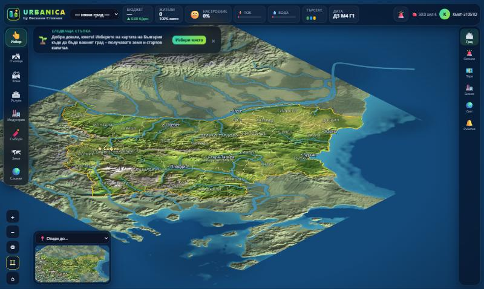     |
| Нов град на избраното място                       | 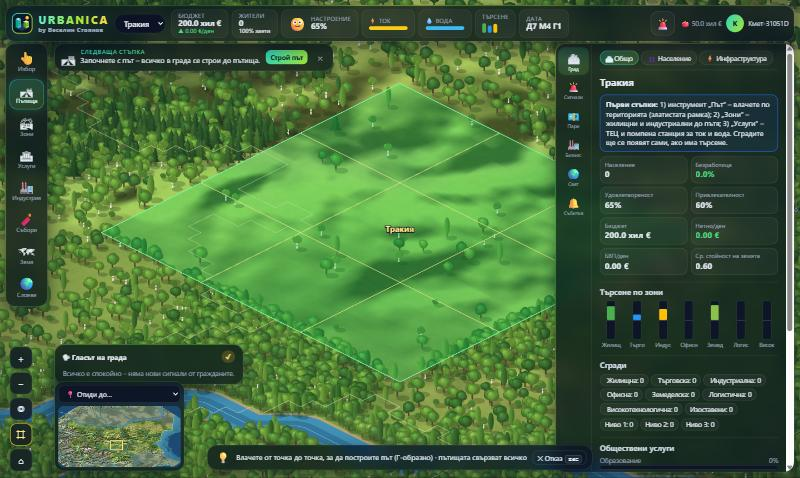 |

## 1. Анализ на старото състояние (етап A)

- **Терен:** всяка плочка беше ромб с един плосък цвят, взет от Perlin шум по плочка → видима решетка, петна, „стъпаловидни“ брегове.
- **Реки:** ивици, където отделен шум е близо до 0 → прави/зигзагообразни, без посока на течението, без притоци и устия.
- **Пътища:** тъмен ромб с два жълти диагонала; без категории, кръстовища, тротоари.
- **Сгради:** обемна кутия в цвета на зоната; дървета и планини – триъгълници.
- **Парцели:** плътни сини/златисти контури върху цялата карта.
- **Технически:** един `Graphics` на град, прерисуван изцяло при всяка промяна; теренът – стотици хиляди многоъгълници.

## 2. Реалната България – данни

Картата е изградена от **отворени данни** със скрипта `scripts/geo/build-bulgaria.mjs` (изтегля ги веднъж, кешира в `.data/geo-cache` и записва `packages/world-generation/src/bulgaria-data.ts`):

| Слой                        | Източник                                                            | Лиценз                              |
| --------------------------- | ------------------------------------------------------------------- | ----------------------------------- |
| Релеф (височини)            | AWS Open Data „Terrain Tiles“ (Terrarium, zoom 7, 25 плочки ≈ 2 MB) | отворени данни (SRTM и др.)         |
| 28 области (граници, имена) | geoBoundaries BGR ADM1 (опростени граници, 256 KB)                  | CC BY 4.0 – посочено в играта и тук |
| Дунав, имена на 27 града    | въведени ръчно (координати)                                         | –                                   |

**Проекция:** картата е „север нагоре“. Всяка клетка 512×512 се преобразува от изометричните екранни координати в географски (изток/север, вертикалата е сплескана 2×), около центъра на България; 1 плочка ≈ 1.8 km. Височините в метри се преобразуват във вътрешна скала (море < 0.4; хълмове от ~700 m; планини от ~1300 m; Мусала ≈ 0.94).

Върху реалния релеф работи същата хидрология: реките (Марица, Искър, Струма, Янтра…) следват истинските долини; Дунав е добавен по реалното си корито. Депресиите в България не стават фалшиви езера (котловините се „преливат“ и реката продължава). Строи се само в България – съседните страни са избледнял фон без строеж, а държавната граница е ярка линия.

Пресъздаване на данните: `node scripts/geo/build-bulgaria.mjs`.

## 2а. Генератор на държавата (`packages/world-generation`)

**Светът започва празен:** няма готови селища, пътища, ниви или язовири – всеки играч основава град на свободна суша и строи всичко от нулата със стартовия капитал. Генераторът създава само природата и административните области.

Детерминистичен по seed и общ за сървъра (валидиране) и клиента (рисуване). Използва само аритметика, `Math.floor` и `Math.sqrt` (без тригонометрия), за да дава идентичен резултат в Node и в браузъра. Пълното генериране на 512×512 отнема ~1 s и се прави веднъж на процес.

| Стъпка       | Файл         | Какво прави                                                                                                                                                                |
| ------------ | ------------ | -------------------------------------------------------------------------------------------------------------------------------------------------------------------------- |
| Силует       | `country.ts` | Една суша с изкривен (domain warping) бряг; ръбовете на света са море.                                                                                                     |
| Релеф        | `country.ts` | Континентален шум + хълмове + **планински вериги** по „гръбнак“ (ridged noise); преходът планина → хълмове → равнина е плавен.                                             |
| Хидрология   | `country.ts` | Priority-flood запълване на депресиите → **езера**; посока на оттичане и натрупан водосбор → **реки** от изворите до морето, езерата или вливането в друга река (притоци). |
| Реки         | `country.ts` | Изгладени полилинии (Чайкин) с **ширина, растяща по течението**; растеризират се в плочки `River`; около тях релефът се „вдълбава“ в **речни долини**.                     |
| Растителност | `country.ts` | Плътност на гората (шум + влажност + хълмове + крайречна растителност) → естествени горски масиви.                                                                         |
| Области      | `country.ts` | 7 центъра на равни обитаеми места (само за разделянето; на картата няма селище) → Вороной с изкривени граници → административни области с имена.                           |
| Обединяване  | `index.ts`   | Класификация на терена, плодородие, находища, риск от наводнение; цялата суша е свободна за строеж.                                                                        |

### Връзка с игровия модел (етап D)

- **Реките** са същите плочки `River`, по които се определят мостовете (цена ×4), близостта до вода за помпите и рискът от наводнение.
- **Плодородието** (слой „Ресурси“) и **находищата** са същите полета, които проверяват правилата за разполагане на фермите, мините и дъскорезниците.

## 3. Пътища и кръстовища

Категориите са част от модела (`TileState.road.c`) и от баланса (`BALANCE.construction.roadClasses`):

| Категория          | Цена | Капацитет | Поддръжка | Визуално                                                         |
| ------------------ | ---- | --------- | --------- | ---------------------------------------------------------------- |
| Улица              | ×1   | ×1        | ×1        | асфалт, тротоари, прекъсната осева линия                         |
| Булевард           | ×3   | ×2.4      | ×2.5      | 4 ленти, зелена разделителна ивица с дървета, лентова маркировка |
| Градска магистрала | ×6   | ×4        | ×4        | разделителна ограда, ленти, банкети                              |
| Индустриален път   | ×1.6 | ×1.5      | ×1.4      | широка настилка, жълта маркировка                                |
| Селски път         | ×0.5 | ×0.6      | ×0.5      | тясна стара настилка, банкети                                    |

Кръстовищата се оформят автоматично според броя и категорията на свързаните пътища: завой (плавна крива), Т-образно, четирипътно (пешеходни пътеки „зебра“), задънена улица. Играчът може да постави на кръстовище с ≥3 пътя **кръгово движение** (400 €, +260 капацитет) или **светофари** (150 €, +150 капацитет, стоп-линии и светофари на картата). На булевардите кръговото движение е голямо.

## 4. Графична архитектура (`apps/web/src/map`)

PixiJS 8 е запазен – производителността и качеството са постигнати със смяна на начина на рисуване, а не на библиотеката.

| Файл          | Роля                                                                                                                                                                                                                                                                                                                                                                                                                                                                                                                                                                                                                                                                                                                                                                                                                                                                                                                                              |
| ------------- | ------------------------------------------------------------------------------------------------------------------------------------------------------------------------------------------------------------------------------------------------------------------------------------------------------------------------------------------------------------------------------------------------------------------------------------------------------------------------------------------------------------------------------------------------------------------------------------------------------------------------------------------------------------------------------------------------------------------------------------------------------------------------------------------------------------------------------------------------------------------------------------------------------------------------------------------------- |
| `paint.ts`    | Рисува **чанк 32×32** в Canvas 2D. Земята се рисува в **световни координати с афинна изометрична трансформация** – кривите, кръговете и ширината на линиите се проектират правилно и не следват решетката. Слоеве: терен (непрекъснато семплиране с хълмово осветяване, плавни брегове чрез размита маска) → реки (бряг, вода, дълбочина, отблясъци) → земя на градовете → пътища на плочки (тротоари, настилка, маркировка, зебри, кръгови) → коли. После обемните обекти, **сортирани по дълбочина**.                                                                                                                                                                                                                                                                                                                                                                                                                                           |
| `sprites.ts`  | Оригинална процедурна библиотека: къщи (едно/двуетажни, с гараж, четирискатни), редови къщи, блокове с балкони, кули (луксозни, стъклени, стъпаловидни), магазини с тенти, супермаркети с паркинг, търговски центрове, хотели, офиси, кампуси, работилници, халета с шедови покриви, заводи с резервоари, складове с рампи и камиони, контейнерни терминали с кран, ферми (плевни, силози, оранжерии), училища, университет, болница с хеликоптерна площадка, полиция, пожарна, автобусно депо, ТЕЦ с охладителна кула, ветрогенератор, помпена станция, пречиствателна станция, сметище, мини, стоманолеярна, соларен парк; 7 вида дървета (дъб, бреза, топола, върба, ела, бор, храст), скали. В територията на град горите се изсичат, за да не закриват сградите. Всеки тип има няколко варианта (цвят на фасадата/покрива, вид покрив, етажност); изборът е по хеш на позицията. Ориентация – входът е към улицата. Кеш по ключ и резолюция. |
| `renderer.ts` | **Нива на детайлност:** държава (< 0.1 – една текстура на цялата държава + имена на области), регион (0.1–0.42 – чанкове с резолюция 0.3, без маркировка), близо (≥ 0.42 – пълна резолюция, маркировка, коли, прозорци). **Прогресивно изграждане** (бюджет ~12 ms на кадър, първо грубите), резервен по-груб чанк, докато подробният се изгражда, **LRU кеш** (24 близки / 90 средни), **culling** по екрана, **инвалидиране само на засегнатите чанкове** при промяна в града. Плавно мащабиране (интерполация към цел), „полет“ до избран град, бутон „цялата държава“, надписи с постоянен размер, дискретни **административни граници** (вкл./изкл.).                                                                                                                                                                                                                                                                                        |

Всеки чанк е **една текстура** → няколко десетки draw call-а за целия екран, лек за телефон.

Аналитичните слоеве (стойност на земята, трафик, ток…), курсорът и парцелите остават като `Graphics` отгоре. Контурите на парцелите се показват само в режим „Собственост“ или фино при активен строителен инструмент.

### Производителност (измерено в браузъра)

| Операция                 | Време                                              |
| ------------------------ | -------------------------------------------------- |
| Генериране на държавата  | ~0.9–1.4 s в Node (веднъж на процес)               |
| Чанк, средно ниво        | 19–50 ms                                           |
| Чанк, близо (гъст град)  | 22–66 ms (първото рисуване на нов спрайт – повече) |
| Чанк, близо (гъста гора) | 35–85 ms (след подобрените дървета)                |

## 4а. Реалистични сгради и дървета (2026-11-11)

Всички спрайтове в `sprites.ts` се рисуват със споделени „материали“ вместо плътни цветове:

- **Светлина и сенки:** стените имат вертикален градиент (по-тъмни долу), покривите – градиент по наклона, ръбовете – светла линия. Под всяка сграда има **размита хвърлена сянка** и тъмна ивица на допира със земята (изпечен ambient occlusion); под стрехите – сянка по стената.
- **Прозорци:** рамка, перваз, отражение на небето, топло осветени прозорци с пердета, сенки над прозорците, плочи между етажите; стъклени фасади с вертикални профили; балкони със стъклени парапети.
- **Покриви:** керемиди на редове, било и стрехи, капандури, комини с шапка; плоските покриви имат парапет, чакъл, машинно помещение, климатици и понякога соларни панели.
- **Детайли:** къщите имат двор с окосена трева, пътека, цветни лехи, жив плет и понякога кола; супермаркетите и моловете – стъклена витрина, козирка над входа, табела, паркинг с маркировка и паркирани коли, светлинни отвори на покрива; халетата и складовете – гофрирана ламарина; охладителните кули – пара.
- **Дървета:** короната е от 10–14 листни купчини, подредени отзад напред, всяка с тъмна долна част, огряна горна, назъбен ръб и отблясъци; изтъняващ ствол с клони; мека елиптична сянка. Елите са на неравни назъбени нива с огряна лява и тъмна дясна страна; върбите имат висящи клонки; брезите – бял ствол с черни петна; ~5 % от листата са есенни; всяко дърво има лек случаен оттенък, за да не е гората еднаква.

**Галерия (само при разработка):** `http://localhost:5173/?gallery` показва всички сгради, съоръжения и дървета върху трева. Параметри: `scale` (мащаб), `only=R,C,tree` (типове), `lvl=1..3` (ниво), `cols` (колони). В продукционния build галерията не влиза.

| Изглед                  | Снимка                                         |
| ----------------------- | ---------------------------------------------- |
| Сгради (ниво 2)         | 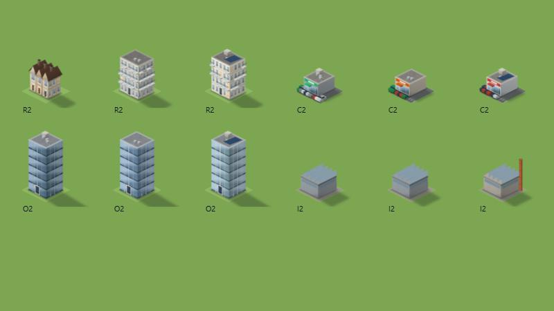     |
| 7 вида дървета          | 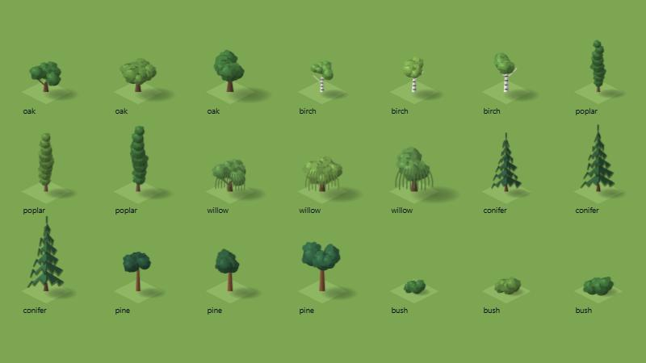        |
| Гора в Родопите отблизо | 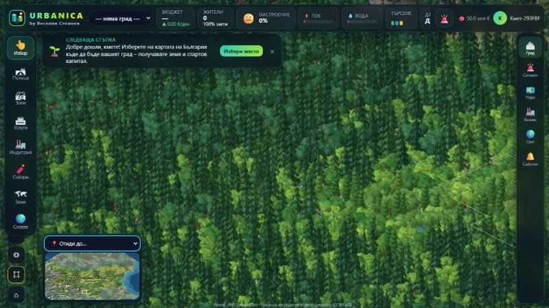 |

## 4б. Трафик и пешеходци (2026-11-11)

Живият трафик е в `apps/web/src/map/traffic.ts`, спрайтовете на колите и хората – в `vehicles.ts`, общата геометрия на пътищата (ленти, тротоари) – в `roadgeom.ts`. Всичко е само визуално в браузъра; икономиката на трафика се смята на сървъра.

**Коли.** 8 модела – седан, хечбек, джип, бус, такси, полиция, градски автобус, камион – нарисувани като 3D обеми (каросерия, кабина със стъкла, гуми, фарове, стопове, сянка) от 16 ъгъла; всеки модел/цвят е една текстура с 16 кадъра. Видът на трафика следва града: автобуси при автобусно депо, полиция при полицейски участък, камиони при индустрия.

**Правила за движение.**

- Дясна лента; плавни криви в завоите; около кръговото кръстовище – обратно на часовника.
- Дистанция по модела на „интелигентния шофьор“: плавно ускоряване и спиране зад колата отпред, без застъпване.
- Влизане в кръстовище само с разрешение: **светофар** – само на зелено, а в кръстовището няма коли от другата посока; **кръгово** – предимство имат колите в кръга; **обикновено** – главен път, после „дясна ръка“; завиващите наляво пропускат насрещните.
- Колата не влиза в кръстовището, ако изходът след него е задръстен; спира пред пешеходец на платното; заобикаля пътища, затворени от сигнал.
- Ако задръстването няма изход (рядко), колата след 14 s тихо „паркира“ и се появява друга.
- Светофарите светят живо (зелено/жълто/червено) според фазата.

**Пешеходци.** Вървят само по тротоари и пешеходни алеи (4 фази на ходене, различни дрехи, деца). Пресичат на кръстовищата (по зебрата), когато няма приближаваща кола. Броят следва дължината на тротоарите и жилищата.

**Пътища.** Тротоарите имат фуги между плочките, бордюр и улични лампи; пътищата без тротоари – банкет. Статичните „паркирани“ коли в лентите са премахнати (пречеха на живия трафик).

**Измерено** (тестов град: 88 сгради, булевард със светофари, кръгово, улици, селски път, парк с алеи): ~35–41 коли и ~70 пешеходци, 0 застъпвания на коли при проверката.

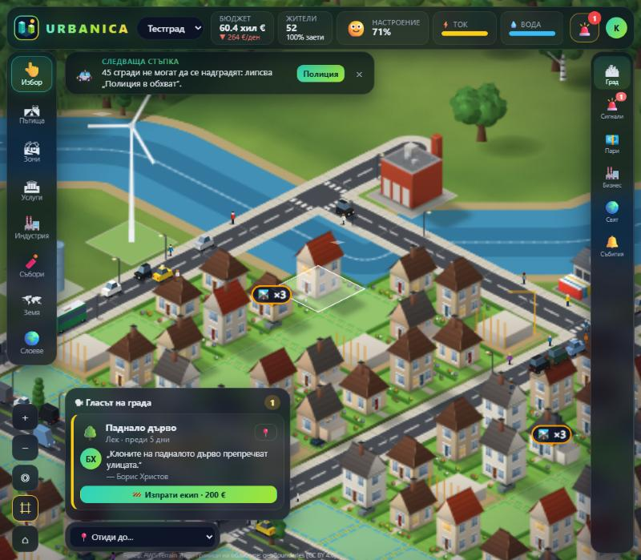

## 4в. Ден и нощ, сезони, време, специални возила (2026-11-11)

- **Колите и хората минават зад сградите.** При близък изглед сградите не се „печатат“ в текстурата на чанка, а са отделни спрайтове, сортирани по дълбочина заедно с колите и пешеходците (`CityActor` в `paint.ts`, `installChunk` в `renderer.ts`).
- **Ден и нощ** (`atmosphere.ts`): цикъл от 8 минути (ден → залез → нощ → изгрев) или фиксиран ден/нощ (бутон 🌓 горе вдясно, помни се в браузъра). Нощем светът се затъмнява (слой с умножение), а адитивно светят уличните лампи (светли петна на тротоара), прозорците, фаровете (конуси) и стоповете (по-ярки при спиране), градовете отдалеч.
- **Сезони** по игровия месец: зимата – сняг по земята (по-дебел в планините), покривите и дворовете, голи широколистни дървета със сняг по клоните, снежни ели; есента – жълто-червени гори и изсъхнала трева; пролетта – по-свежа зеленина. При смяна на сезона чанковете се прерисуват.
- **Време** (еднакво за всички играчи, по игровия ден и сезона): дъжд, сняг, буря със светкавици; облачното време притъмнява картата. При снеговалеж излизат **снегорини**.
- **Специални возила:** когато изпратите екип по сигнал, от съответната обществена сграда тръгва возило с мигаща лампа (ремонтен бус, линейка, сметосъбирачна кола…), стига по най-краткия път и стои на мястото до края на ремонта.
- **Автобусни линии:** автобусите обикалят всички спирки и спират на всяка за 3 s.
- **Задръствания от симулацията:** натоварването на пътищата от сървъра определя броя на колите и скоростта им по задръстените улици.
- **Мостове и тунели**, **магистрали между градовете** (тъмна лента с жълта ос от център до център).
- **Рисуване във фонова нишка:** чанковете се рисуват в Web Worker с `OffscreenCanvas` (`paint.worker.ts`), с отделно копие на генератора на света; главната нишка само показва готовите изображения. Без поддръжка на `OffscreenCanvas` – рисуване в главната нишка, както досега.

| Изглед                            | Снимка                                          |
| --------------------------------- | ----------------------------------------------- |
| Нощ през зимата                   | 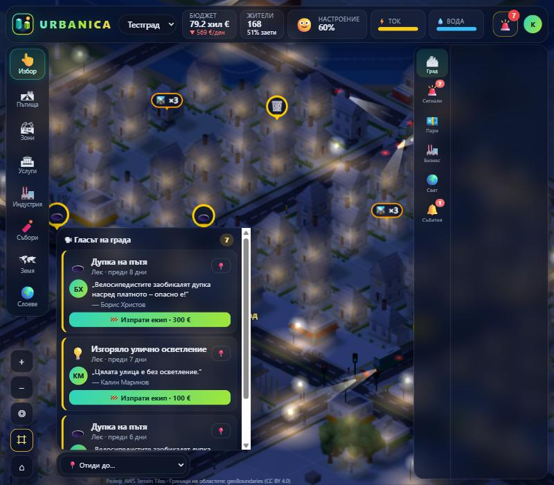      |
| Сняг, голи дървета, ремонтен бус  | 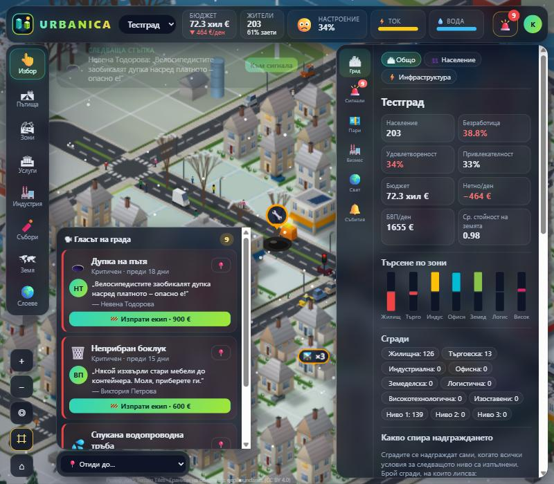      |
| Телефон: сезон, време, магистрала | 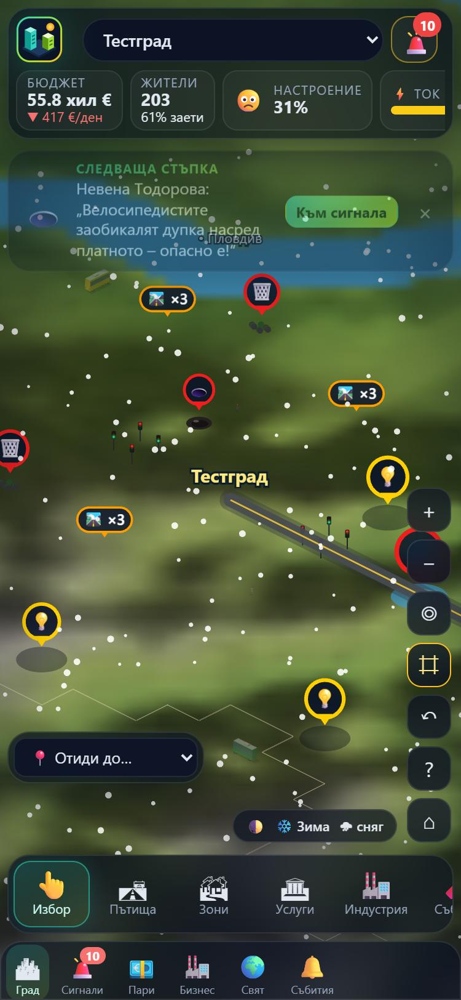 |

## 4г. Жив град и нов интерфейс

**Жив слой** (`apps/web/src/map/life.ts`, PixiJS, обновява се всеки кадър):

- **Коли** по пътищата на играчите – движат се плочка по плочка вдясно от осовата линия, завиват по кръстовищата и заобикалят затворени от сигнал пътища (до 160, броят следва дължината на мрежата).
- **Дим** от ТЕЦ, заводи и индустриални сгради.
- **Сенки от облаци**, които бавно се носят над държавата.
- **Отблясъци** на слънцето по видимата вода.
- **Сигнали** – пулсиращи маркери с икона (жълт/оранжев/червен по степен, 🔧 при ремонт) и следи на терена.

**Интерфейс** („Жив град“): картата е на цял екран, всичко останало е в плаващи стъклени карти.

- **Пулс на града** – бюджет с тенденция, жители, настроение (емоджи), ток и вода като индикатори, търсене R/C/I, дата и камбанка със сигналите.
- **Док с инструменти** – големи икони, менюта с карти (икона, кратко обяснение, цена).
- **„Следваща стъпка“** – съветник, който казва какво да се направи сега (път → жилища → ток → вода → спешни сигнали → какво спира надграждането) и има бутон, който избира нужния инструмент.
- **„Гласът на града“** – последните сигнали с цитат от гражданина и бутон „Изпрати екип“.
- **Телефон** – инструментите и разделите са отдолу, панелът е подвижен лист, който по подразбиране е затворен, за да се вижда картата.

| Изглед                 | Снимка                                           |
| ---------------------- | ------------------------------------------------ |
| Нов интерфейс          | 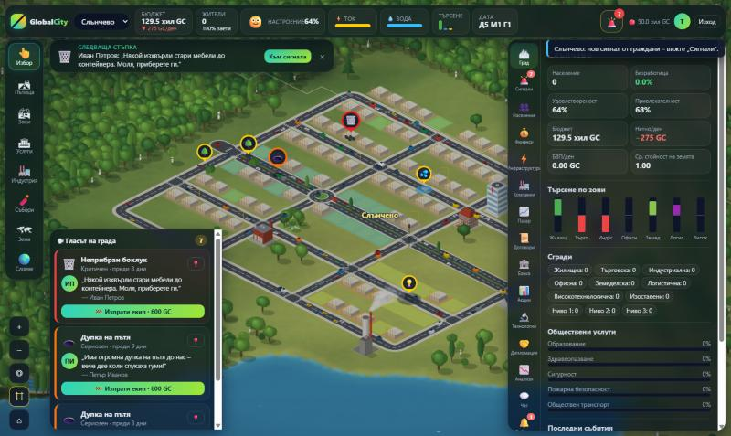   |
| Сигнали и коли отблизо | 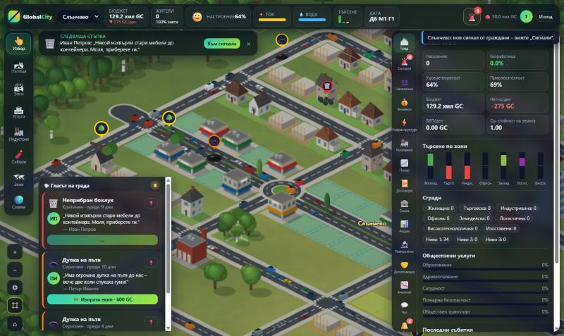 |
| Телефон                | 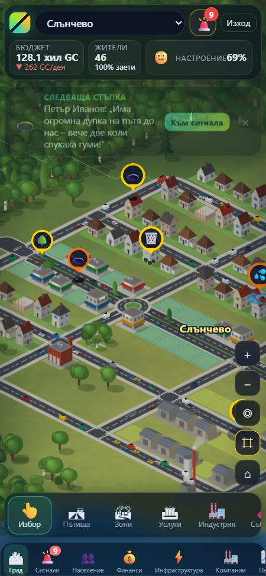         |

## 5. Ограничения и следващи стъпки

- **Без истинско 3D/сенки в реално време:** сенките и осветлението са „изпечени“ в спрайтовете (светлина отгоре-вляво). Има само изпечена сянка на допира със земята, без истински ambient occlusion между сградите.
- **Спрайтовете на сградите** при близък изглед още се рисуват в главната нишка (кеширани по вид – всеки вид само веднъж).
- **Пътищата на играча са по плочки** (с плавни завои и автоматични кръстовища); свободно криволинейно чертане, надлези, тунели и пътни възли с рампи още няма.
- **Транспортът** използва категорията и кръстовищата за капацитет, но още не прокарва маршрути по графа; пътищата между градовете на различни играчи не влияят на цената на транспорта.
- **Наводненията** използват същите полета (риск по плочка); динамично покачване на водата и промяна на водните запаси не са реализирани.
